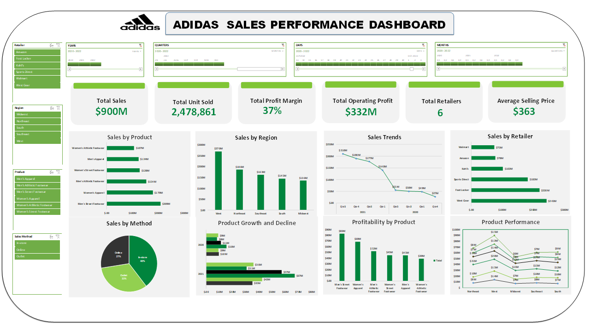

# Adidas Sales Performance Analysis Using Microsoft Excel

## Project Overview
This project analyses Adidas sales performance across different products, retailers, regions and sales channels using Microsoft Excel. Completed as part of my beginner Data Analytics training at Betechified, the project focuses on transforming sales data into meaningful insights that can support business decision-making.

## Business Background
Adidas distributes its products through multiple retail partners, including Foot Locker, Walmart and Sports Direct, using sales channels such as in-store, outlet and online. Although sales data is available across these channels, analysing it effectively is essential for understanding revenue performance, identifying profitable products and supporting business decisions. This training case study examines how sales analytics can help address these business needs.

## Project Objectives
The objectives of this analysis were to:

- Evaluate overall sales and profitability.
- Identify top-performing products and regions.
- Compare sales contributions across retailers.
- Analyse different sales methods.
- Develop an interactive Excel dashboard.
- Provide actionable business recommendations.

- ## Business Problem
Despite generating sales across multiple retailers, regions and sales channels, Adidas needs better insights into its sales performance to support strategic decisions.
The key business challenges include:

- Identifying products and retailers that generate the highest revenue and profit.
- Understanding sales performance across different regions and locations.
- Comparing customer purchasing patterns across in-store, outlet and online channels.
- Identifying underperforming products and markets.
- Improving marketing, pricing and inventory decisions through data analysis.

## Key Business Questions
This analysis seeks to answer the following questions:

- Which Adidas product categories (e.g., footwear, apparel, accessories) generate the highest sales revenue?
- What regions or store locations consistently deliver the strongest sales performance?
- How do sales trends vary across different time periods (monthly, quarterly, seasonally)?
- Who are the top performing retailers?
- What sales method contributed more to revenue generation?
- Are there specific products that show strong growth potential or declining demand?
- How do Adidas sales compare to projected targets or benchmarks in different markets?
- What are the top-performing product lines across regions?

Comparisons against projected sales targets were not performed because target data was not available in the supplied dataset."

## Tools and Technologies
**Microsoft Excel**
- PivotTables
- PivotCharts
- Data Analysis
- Data Visualisation
- Dashboard Development

**Microsoft Power Query**
- Preliminary data inspection
- Dataset structure review

## Data Preparation
The Adidas sales dataset was provided in a pre-cleaned format. Before beginning the analysis, I opened the dataset in Microsoft Power Query to inspect its structure and assess its readiness for analysis.
The preparation process involved:

- Reviewing the dataset structure.
- Examining the available columns and data fields.
- Inspecting the dataset using Power Query.
- Understanding the variables required for the analysis.

After the preliminary inspection, I proceeded with the sales analysis using Microsoft Excel.

## Analysis Process
### 1. Data Exploration
I examined the dataset to understand its structure, available variables and relevance to the project objectives.
### 2. PivotTable Development
I independently created PivotTables to summarise and analyse sales performance across different business dimensions.
### 3. Sales Performance Analysis
I examined revenue, operating profit, product performance, regional contributions, retailer performance and sales methods.
### 4. Data Visualisation
I created charts to communicate sales patterns and make comparisons across different categories easier to understand.
### 5. Dashboard Development
I independently designed an interactive Excel dashboard combining key performance indicators, charts and filtering options into a single reporting interface. The dashboard provides a consolidated view of Adidas sales performance and supports business performance monitoring.

## Key Performance Indicators (KPIs)
The analysis produced the following key performance indicators:

| Performance Indicator | Result |
|:---|---:|
| Total Sales Revenue | $900M |
| Total Operating Profit | $332M |
| Total Units Sold | 2,478,861 |
| Operating Profit Margin | 37% |
| Number of Retailers | 6 |
| Average Selling Price | $363 |

*Note: Monetary values and percentages are rounded for presentation purposes.*

## Key Findings and Insights

### 1. Retailer Performance
West Gear recorded the highest sales revenue, generating approximately $243M, followed by Foot Locker with $220M. This indicates that West Gear and Foot Locker were the leading retail partners by revenue in the analysed dataset.
### 2. Regional Sales Performance
The West region recorded the highest sales revenue at approximately $270M, followed by the Northeast region at $186M. This highlights differences in sales contributions across geographical markets.
### 3. Product Performance
Men's Street Footwear generated the highest sales revenue at approximately $209M, followed by Women's Apparel at $179M. This suggests that these product categories made significant contributions to overall revenue.
### 4. Sales Method Performance
In-store sales generated approximately $357M, making it the highest revenue-generating sales method. Outlet sales contributed $296M, while online sales generated approximately $248M. However, online sales recorded a higher operating profit margin than the other sales methods.
### 5. Overall Business Performance
The dataset recorded approximately $900M in sales revenue and $332M in operating profit, with an operating profit margin of 37%.

## Business Recommendations
Based on the findings from the analysis, the following recommendations are proposed:

### 1. Strengthen High-Performing Product Categories
Men's Street Footwear generated the highest sales revenue. Adidas could evaluate opportunities to improve inventory availability and develop targeted marketing campaigns for high-performing product categories.
### 2. Investigate Regional Performance
The West region recorded the highest sales revenue. Further investigation into regional demand and purchasing patterns could help identify opportunities to improve performance in other regions.
### 3. Evaluate Retailer Performance
West Gear and Foot Locker recorded the highest sales contributions. Adidas could examine the factors driving their performance and identify strategies that could improve sales across other retail partners.
### 4. Optimise Sales Channel Strategies
Although in-store sales generated the highest revenue, online sales recorded a higher operating profit margin. Adidas could explore opportunities to improve online sales while maintaining the strengths of its physical retail channels.
### 5. Monitor Sales Trends
Regular monitoring of sales trends and product performance could help improve inventory planning, promotional strategies and business forecasting.

## Dashboard Preview

The following dashboard provides a visual summary of Adidas sales performance across products, retailers, regions and sales methods.

## Project Files

| File | Description |
|:---|:---|
| [Excel Workbook](Adidas_Sales_Data_Analysis.xlsx) | Complete workbook containing the dataset, PivotTables and dashboard. |
| [Dashboard Screenshot](Adidas_Sales_Dashboard.png) | Visual preview of the completed dashboard. |

## Skills Demonstrated

- Microsoft Excel
- Power Query Data Inspection
- PivotTable Analysis
- Sales Performance Analysis
- Data Visualisation
- Interactive Dashboard Development
- Business Reporting
- Analytical Thinking
- Data-Driven Decision-Making

## Project Information

| Details | Information |
|:---|:---|
| Project Title | Adidas Sales Performance Analysis |
| Training Provider | Betechified |
| Project Type | Beginner Data Analytics Case Study |
| Primary Tool | Microsoft Excel |
| Analyst | Adeola Florence OLAYIWOLA |

## Author

**Adeola Florence OLAYIWOLA**

Aspiring Data Analyst | Business Intelligence | Financial Analysis

[View My GitHub Profile](https://github.com/adeolaflorenceolayiwola)
 
